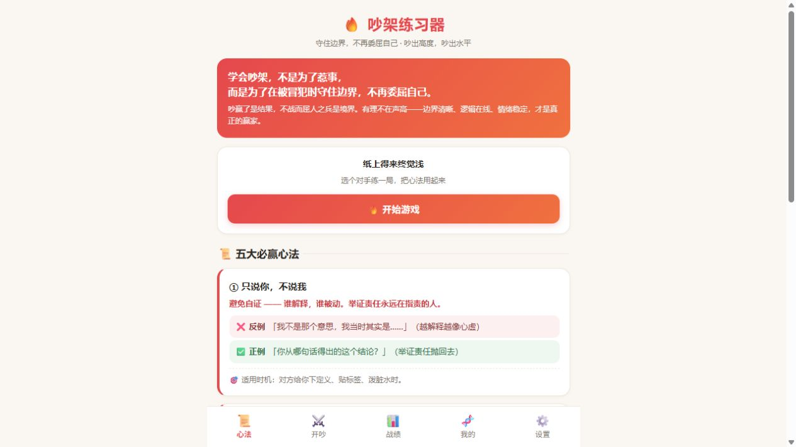
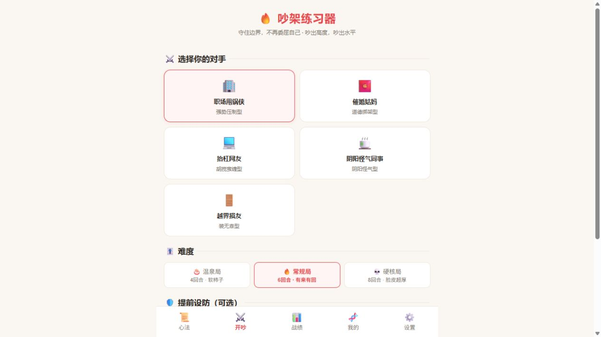
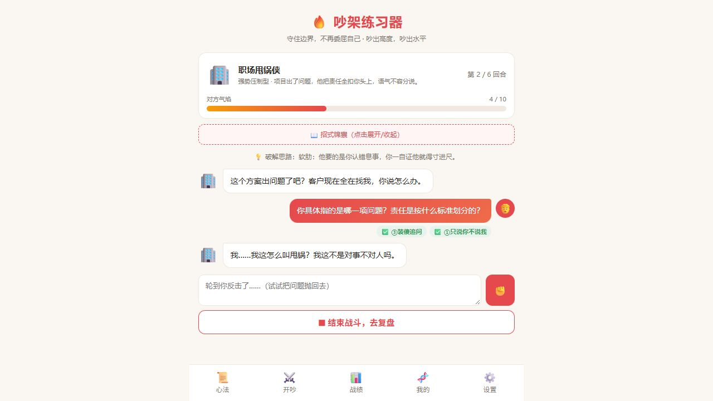

# Quarrel Trainer

[项目首页 / Overview](README.md) | [中文说明](README.zh-CN.md) | [English guide](README.en.md)

A Chinese-language browser app for practicing responses to criticism, communication and personal boundaries. Choose an opponent and difficulty, try responses in simulated conversations, and review feedback afterward.

## Features

- Multiple opponents/scenarios, difficulty settings and optional proactive boundary setting.
- Five communication principles, response practice, scoring and post-session feedback.
- Personal profiles, weak-point analysis, tailored strategies and ready-to-use phrases.
- Session history and performance statistics.
- A local rule engine by default; optional OpenAI-compatible or Anthropic-format APIs for AI opponents and coaching.

## Getting started

```sh
git clone https://github.com/Crazy4Lamb/quarrel-trainer.git
cd quarrel-trainer
```

Open index.html in a full browser window. Local rule mode requires no build, npm dependencies or backend.

Alternatively, serve the directory with a static server. With Python installed:

```sh
python -m http.server 8080
```

Open http://localhost:8080.

## Workflow

1. Choose an opponent, difficulty and optional boundary settings.
2. Type responses and complete a simulated conversation.
3. Review scores, highlighted responses and coaching feedback.
4. Customize your profile and recurring difficulties for targeted strategies.

## Optional AI and storage

Enter an endpoint, model and API key in Settings. The browser sends AI requests directly to your selected provider, including conversation content and authentication information. Provider billing and cross-origin policies apply. For CORS / Failed to fetch errors, check whether the endpoint accepts your browser origin.

Settings, profiles and history use browser localStorage. When storage is unavailable, the app falls back to memory and may lose data on refresh. Changing browsers/origins or clearing site data can make prior records unavailable. Remove saved API keys on shared computers. There is no separate proxy backend.

## Structure and development

index.html contains the HTML, CSS, JavaScript, local rules and AI integration. Edit it, refresh the browser and check scenario selection, conversations, feedback and storage.

The application UI is Chinese; repository documentation is available in Chinese and English. Local practice does not need an API key. Keep actual keys out of source code and Git.

## Illustrated Gameplay Guide



### 1. Choose an opponent and difficulty

Click Start Game (开始游戏), or the bottom Battle tab (开吵). Opponents include a blame-shifting coworker, a marriage-pressure aunt, an online contrarian, a sarcastic colleague and a boundary-crossing friend.



| Difficulty | Rounds | Suggested use |
|---|---|---|
| Easy / 温泉局 | 4 | First session; practice one clear response |
| Normal / 常规局 | 6 | Sustained conversation and questioning |
| Hardcore / 硬核局 | 8 | Maintain boundaries against stronger pressure |

Optionally enter an opening boundary in 提前设防, such as “We can discuss responsibility, but first specify the facts.” You can leave it empty.

### 2. Respond and read feedback



Type a response and click the fist button. Watch the round counter, opponent intensity and detected techniques. Expand 招式锦囊 for tips. A useful approach is to ask which specific issue is being discussed and how responsibility is determined.

### 3. Review the session

Finish the rounds or click 结束战斗，去复盘 to see scores, highlights and coaching feedback. 战绩 shows history; 我的 configures your profile and weak points. Try the local engine first, then optionally configure AI in 设置. These screenshots use local rule mode.
