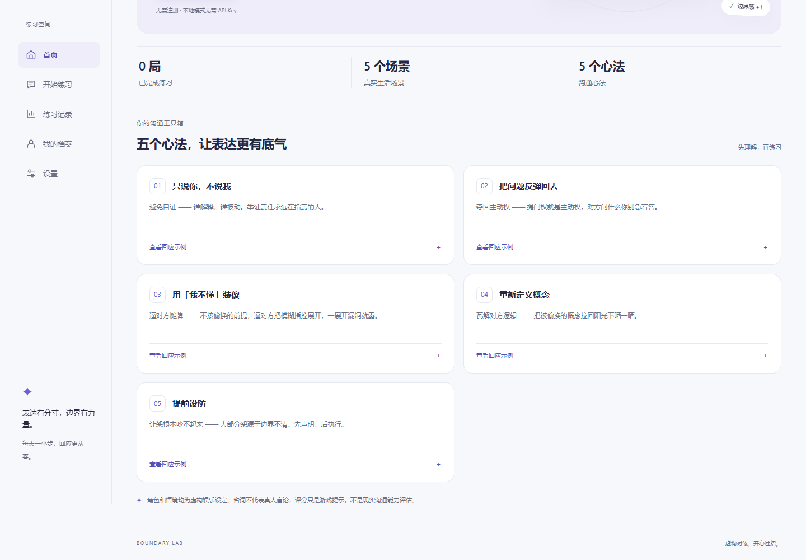
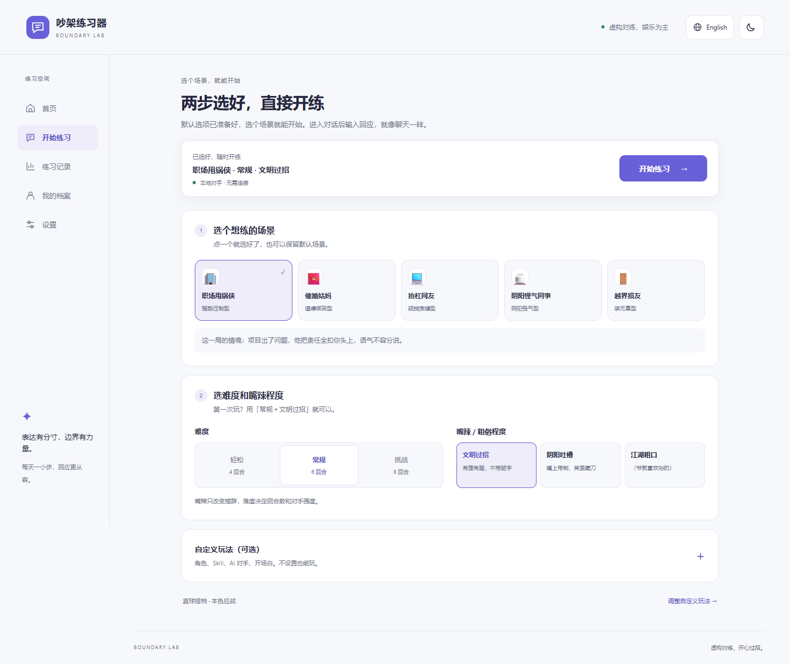
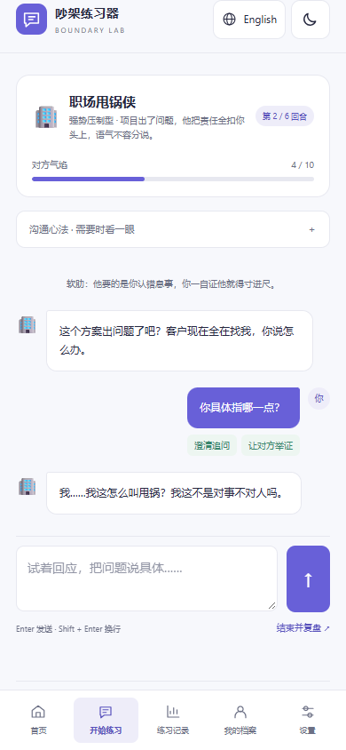

# Quarrel Trainer

[项目首页 / Overview](README.md) | [中文说明](README.zh-CN.md) | [English guide](README.en.md)

A Chinese/English browser app for practicing responses to criticism, communication and personal boundaries. Choose an opponent and difficulty, try responses in simulated conversations, and review feedback afterward.

## Features

- Multiple opponents/scenarios, difficulty settings and optional proactive boundary setting.
- A comeback lab with original fictional characters and a sample line before playing.
- Four built-in style skills, JSON/Markdown import, JSON export and a bilingual offline example pack.
- Independent difficulty and spice/profanity controls: clean, sarcastic or coarse (yep, keep it crude).
- Explicit offline-preset and dynamic-AI modes, including in the portable edition. Offline mode makes no AI calls even with a saved key.
- Five communication principles, response practice, scoring and post-session feedback.
- Personal profiles, weak-point analysis, tailored strategies and ready-to-use phrases.
- Session history and performance statistics.
- Fresh AI openings: a new situation, first line and tip in the selected language, with recent-opening checks and preset fallback.
- Chinese/English interfaces, scenario dialogue and feedback; light, dark and system themes with saved preferences.
- Desktop sidebar and mobile bottom navigation, expandable examples and session resuming.
- A local rule engine by default; optional OpenAI-compatible or Anthropic-format APIs for AI opponents and coaching.

## Getting started

### Mobile H5: open the site and add it to your home screen

[Open the mobile web edition](https://crazy4lamb.github.io/quarrel-trainer/) · [Download the H5 deployment ZIP](https://github.com/Crazy4Lamb/quarrel-trainer/raw/refs/heads/main/downloads/quarrel-trainer-h5.zip)

This is an installable web app (PWA), with no APK or app store required. On Android, open it in Chrome/Edge and use the page’s Install to home screen button or the browser’s Install app/Add to home screen menu. On iPhone, use Safari → Share → Add to Home Screen, leaving Open as Web App enabled if offered. Open in the system browser if an in-app browser has no install option.

After the first online visit finishes caching, preset sessions can reopen offline. AI still needs a network connection and a complete API configuration. Settings show when offline content is ready. Installation requires HTTPS (localhost works for development), not a local HTML file or ordinary phone-to-LAN HTTP URL. Updates are offered explicitly and do not interrupt an unfinished session. Local-file and web editions use different browser storage; records and API settings are not automatically transferred.

For your own HTTPS static host, run `node scripts/build-h5.cjs` and upload the contents of `dist/h5/`, keeping the manifest files, service worker and icons. Subdirectory hosting is supported. See [MDN’s installation guide](https://developer.mozilla.org/en-US/docs/Web/Progressive_web_apps/Guides/Making_PWAs_installable) for browser-specific requirements.

### Portable edition: download, extract and double-click

[Download the portable ZIP](https://github.com/Crazy4Lamb/quarrel-trainer/raw/refs/heads/main/downloads/quarrel-trainer-local.zip)

Extract `quarrel-trainer-local.zip`, then double-click `Start.html`. Alternatively, save and open the standalone `quarrel-trainer-local.html`. All styles, scripts and Chinese/English presets are embedded. No installation, Node.js, Python, plugins or local server is required.

Preset practice, reviews, history, languages and themes work offline. AI-generated content still requires an Internet connection and a complete API configuration. Settings and records live in your browser; keep using the same browser and file location. Moving the file, changing browsers or clearing browser data may make earlier records unavailable.

### Maintainers: build the distribution

From the project root (only the person building the files needs Node.js; no npm dependencies):

```sh
node scripts/build-local.cjs
```

Run `node scripts/build.cjs` to build both editions and refresh the offline cache version. After editing the app, run it before publishing and commit `service-worker.js` and `downloads/` so installed users receive an update prompt.

The build also refreshes the ZIP in `downloads/`. Commit that file to keep the GitHub download in sync with the source.

This creates `dist/quarrel-trainer-local.zip` with an HTML entry, usage instructions and a skill example, plus the standalone `dist/quarrel-trainer-local.html`. Share either file directly with users. The build includes application code, not API keys, profiles or records saved in your browser.

### Running from source

```sh
git clone https://github.com/Crazy4Lamb/quarrel-trainer.git
cd quarrel-trainer
```

Open index.html in a full browser window. Local rule mode requires no build, npm dependencies or backend. Keep all app styles/scripts, manifests, service-worker.js and the icons/ directory together.

Alternatively, serve the directory with a static server. With Python installed:

```sh
python -m http.server 8080
```

Open http://localhost:8080.

## Workflow

Home counts show completed sessions, available scenarios and techniques. The setup page shows two short steps with a start action that stays visible while scrolling. Characters, skills, AI and opening text are in the optional, initially collapsed Customize your game section.

1. Pick a situation. First-time players can keep Normal + Clean.
2. Select Start practice at the top, then type a response as you would in a chat. Expand Customize your game only if you want characters, skills, AI or an opening line.
3. Type responses and continue the conversation within this session’s situation.
4. Review scores, highlighted responses and coaching feedback.
5. Customize your profile and recurring difficulties for targeted strategies.

## Appearance and language

The app starts in Chinese for Chinese-language browsers and English otherwise. Your manual language choice is saved. Use the top-right globe/language and theme buttons, or Settings → Appearance & language. The system theme responds to your device preference. English mode includes English opponents, response detection and reviews. Existing messages and user input retain their original wording; switching preserves the current session and unsaved form drafts.

## Fictional entertainment and content sources

The character cards use fictional archetypes and simple original letter-based graphics, with no real-person likenesses or franchise character choices. Shared generation rules require fresh dialogue, no recognizable quotes or catchphrases, no impersonation and no implied endorsement. The rules also apply to custom notes and imported skills.

This design reduces reliance on existing identities and material; it does not verify rights automatically. Import content you created or have permission to use, and review model output and third-party skills.

## Personas, skills and spice

Open Play → Customize your game to choose Straight Talker, Dry Wit, Logic Detective or Drama Buddy. Add personality notes and try a sample line. Choose a built-in skill or import JSON/Markdown. See [the skill format](skills/README.md) and [the bilingual example](skills/reviewer.json). Skill files provide text/data; they do not execute code.

Difficulty changes rounds and opponent pressure; spice changes wording. Offline mode combines skill presets with clean, sarcastic or coarse delivery. AI mode uses your persona, skill, spice level and session situation. Custom persona directions and instruction-only Markdown skills require AI to generate new dialogue; skills without offline lines for the current language visibly fall back to default presets. Changing options applies to future sessions; the current session keeps its initial settings.

## Optional AI and storage

In AI mode, with a complete API URL, key and model configuration, each new session generates a fresh situation, opponent opening and practice tip. Subsequent replies use this session’s situation. Recent openings help avoid repetition. Without a configuration, the app loads preset content directly. Invalid or repeated output is retried at most once within a shared 15-second generation deadline. Failures and timeouts fall back to presets; you can switch to a local opponent while waiting. Recent AI opening records help reduce repetition and are removed when browser site data is cleared.

Enter an endpoint, model and API key in Settings. The browser sends AI requests directly to your selected provider, including conversation content and authentication information. Provider billing and cross-origin policies apply. For CORS / Failed to fetch errors, check whether the endpoint accepts your browser origin.

Settings, language/theme preferences, profiles and history use browser localStorage. When storage is unavailable, the app falls back to memory and may lose data on refresh. Changing browsers/origins or clearing site data can make prior records unavailable. Remove saved API keys on shared computers. There is no separate proxy backend.

## Structure and development

index.html is the page entry; styles.css defines responsive layouts and themes; i18n.js contains translations and English practice data; skills.js contains original characters, skills and generation constraints; app.js handles scoring, AI, storage and interactions. pwa.js handles installation and offline status; manifest*.webmanifest and icons/ define the home-screen app. service-worker.js is generated by scripts/build-h5.cjs: edit scripts/service-worker-template.js and rebuild to change it.

With Playwright installed, run `node tests/browser.cjs` for browser regression checks and `node tests/openings.cjs` for fresh openings, duplicate retries, cancellation and preset fallback (Edge on Windows by default; BROWSER_CHANNEL can select another installed Chromium channel). Tests use mocked APIs and fake keys.

Run `node tests/local.cjs` to build the portable files and check ZIP extraction, portable filenames, offline practice, reviews, persistence, languages and themes from a local file, with no external resource requests.

Run `node tests/styles.cjs` for skill import/export, persona and spice controls, mode isolation and AI prompt integration. Portable tests also check imported skills and API-key mode, using mocked API responses.

Both the interface and documentation support Chinese and English. Scores use local heuristic rules and are practice cues, not a measure of real communication ability. Local practice does not need an API key. Keep actual keys out of source code and Git.

## Illustrated Gameplay Guide



### 1. Choose an opponent and difficulty

Click Start Game (开始游戏), or Practice (开始练习) in the navigation. Opponents include a blame-shifting coworker, a marriage-pressure aunt, an online contrarian, a sarcastic colleague and a boundary-crossing friend.



| Difficulty       | Rounds | Suggested use                                 |
| ---------------- | ------ | --------------------------------------------- |
| Easy / 轻松      | 4      | First session; practice one clear response    |
| Normal / 常规    | 6      | Sustained conversation and questioning        |
| Challenge / 挑战 | 8      | Maintain boundaries against stronger pressure |

Expand Customize your game to optionally enter an opening boundary in Your opening line, such as “We can discuss responsibility, but first specify the facts.” You can leave it empty.

### 2. Respond and read feedback



Type a response and click the up-arrow button (or press Enter on desktop; Shift + Enter inserts a line break). Watch the round counter, opponent intensity and detected techniques. Expand Your toolkit (沟通心法) for tips. A useful approach is to ask which specific issue is being discussed and how responsibility is determined.

### 3. Review the session

Finish the rounds or click End & review (结束并复盘) to see scores, highlights and coaching feedback. History (练习记录) shows past sessions; Profile (我的档案) configures your profile and weak points. AI errors or timeouts fall back to local opponents for the rest of the session; you can also switch manually while waiting. Try the local engine first, then optionally configure AI in 设置. These screenshots use local rule mode.

Run `node tests/international.cjs` to check browser-language defaults, translated character selection, generation constraints, responsive layouts and the English offline bundle.

Run `node tests/setup.cjs` to verify readable counts, collapsed optional controls, default start, live selection summaries, a visible start button at all widths and the same flow in the portable bundle.

Run `node tests/pwa.cjs` to check real service-worker scope, offline reload/play, explicit updates with retained records, uncached API requests, install controls and keyboard layout. Safari install instructions follow platform conventions; these checks do not constitute a physical-iPhone installation test.
