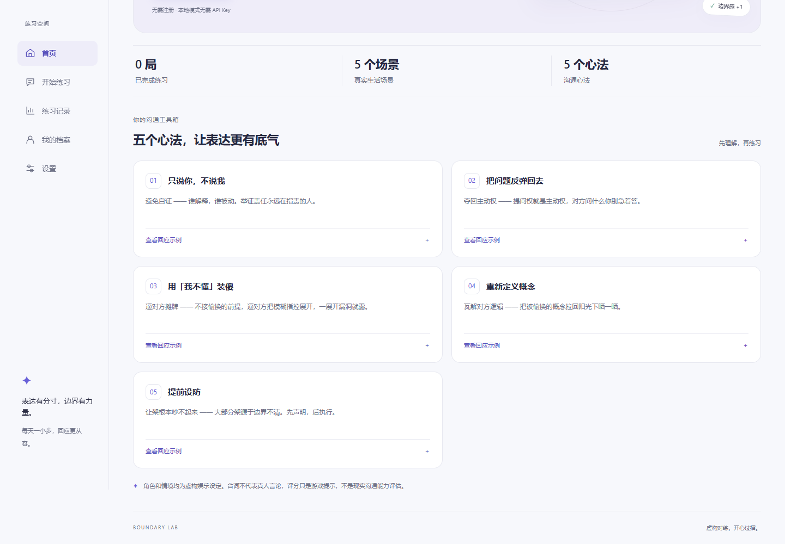
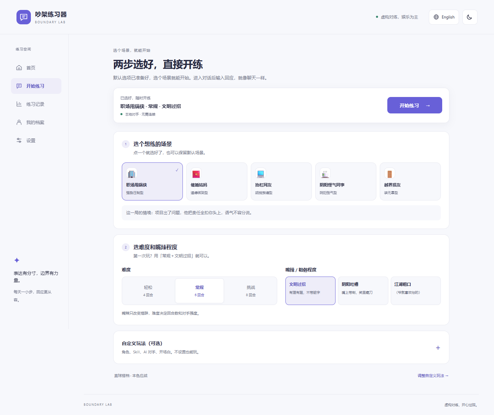
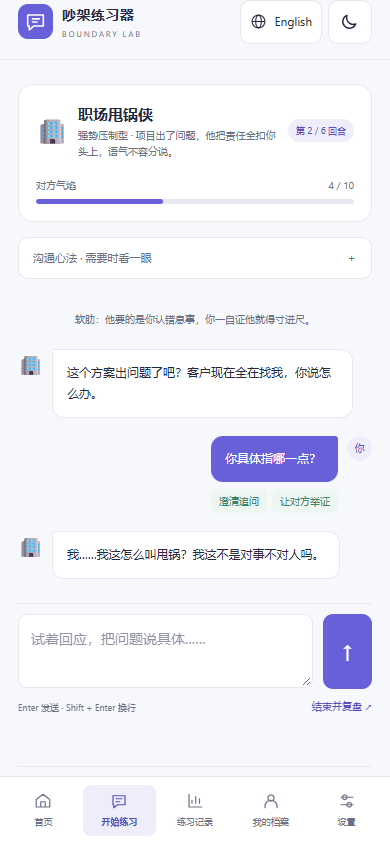

# 吵架练习器 / Quarrel Trainer

一个支持中英文、明暗主题的沟通练习网页应用。在安全的模拟对话中练习从容回应、澄清事实和表达边界。

A bilingual communication practice app with light and dark themes. Rehearse calm responses, clear questions and personal boundaries in simulated conversations.

[中文说明](README.zh-CN.md) | [English guide](README.en.md)

[手机打开 / Open installable H5](https://crazy4lamb.github.io/quarrel-trainer/) · [H5 部署包 / Deployment ZIP](https://github.com/Crazy4Lamb/quarrel-trainer/raw/refs/heads/main/downloads/quarrel-trainer-h5.zip)

[下载本地版 ZIP / Download portable ZIP](https://github.com/Crazy4Lamb/quarrel-trainer/raw/refs/heads/main/downloads/quarrel-trainer-local.zip) — 解压后双击 `Start.html`；无需安装。Extract and open `Start.html`; no installation required.

---

# 中文说明

[项目首页 / Overview](README.md) | [中文说明](README.zh-CN.md) | [English guide](README.en.md)

一个用于练习沟通、应对指责和表达个人边界的中英文网页应用。选择对手与难度，在模拟对话中练习回应，再通过复盘改进表达。

## 功能

- 多种对手与场景、可选难度和提前设防。
- 回怼实验室：选择原创虚构搭档并补充性格特点，先看一句回怼示范再开局。
- 四个内置风格 Skill；支持导入 JSON / Markdown、导出和移除技能，附带可离线试用的技能示例。
- 难度与嘴辣程度分开设置：文明过招、阴阳吐槽、江湖粗口（爷就喜欢俗的）。
- 本地版可明确选择「预置·离线」或「AI·动态」；即使保存了 Key，离线模式也不会调用 AI。
- 五大沟通心法、回应练习、评分与赛后点评。
- 个人档案、沟通软肋分析、专属策略及应急话术。
- 对战记录与战绩统计。
- AI 动态开局：按对手与当前语言生成新情境、开场和提示，参考近期记录避免重复；生成失败可回退本地预置。
- 中英文界面、场景台词与练习反馈；浅色、深色及跟随系统主题，偏好自动保存。
- 桌面侧边导航、手机底部导航、可展开的心法示例与继续练习入口。
- 默认本地规则引擎；可在设置中接入 OpenAI 兼容接口或 Anthropic 格式接口，启用 AI 对手及教练点评。

## 快速开始

### 手机 H5：打开网页，安装到主屏幕

[打开手机网页版](https://crazy4lamb.github.io/quarrel-trainer/) · [下载 H5 部署包](https://github.com/Crazy4Lamb/quarrel-trainer/raw/refs/heads/main/downloads/quarrel-trainer-h5.zip)

这是可安装的 H5（PWA），无需 APK 或应用商店。Android 在 Chrome / Edge 中打开后，点页面「安装到主屏幕」，或使用浏览器菜单里的「安装应用 / 添加到主屏幕」。iPhone 用 Safari 打开，点「分享 → 添加到主屏幕」；如果有「作为网页 App 打开」选项，请保持开启。内置浏览器没有安装选项时，先在系统浏览器打开。

首次联网打开并完成缓存后，内置练习可以离线重开；AI 对话仍需联网与完整 API 配置。设置里会显示离线内容是否就绪。安装需要 HTTPS（开发时 localhost 也可），直接打开本地 HTML 或手机访问普通局域网 HTTP 地址不能安装。安装入口会提供对应平台的说明。

网站有新版本时会显示更新按钮，由使用者决定何时刷新；正在进行的练习会先要求结束并保存。本地文件版与网页版使用不同的浏览器存储空间，记录和 API 配置不会自动互通。

部署到自己的 HTTPS 静态网站：运行 `node scripts/build-h5.cjs`，把 `dist/h5/` 的内容上传，保持目录结构。`manifest*.webmanifest`、`service-worker.js` 与 `icons/` 必须一起部署。项目子目录部署也支持。

安装要求与浏览器差异可参考 [MDN 的 PWA 安装说明](https://developer.mozilla.org/en-US/docs/Web/Progressive_web_apps/Guides/Making_PWAs_installable)。

### 本地便携版：下载、解压、双击

[下载本地版 ZIP](https://github.com/Crazy4Lamb/quarrel-trainer/raw/refs/heads/main/downloads/quarrel-trainer-local.zip)

收到 `quarrel-trainer-local.zip` 后，先解压，再双击文件夹里的「Start.html」。也可以单独保存并打开 `quarrel-trainer-local.html`。单文件已包含全部样式、脚本和中英文预置内容，无需安装程序、Node.js、Python、插件或启动服务。

内置练习、复盘、历史记录、语言和主题切换均可离线使用。AI 动态生成仍需联网和完整的 API 配置。设置与记录保存在浏览器中，建议固定文件位置并使用同一浏览器；移动文件、更换浏览器或清理浏览器数据后，原记录可能不可见。

### 维护者：生成可分发文件

在项目根目录运行（仅打包者需要 Node.js，无需安装 npm 依赖）：

```sh
node scripts/build-local.cjs
```

同时生成 H5 和本地版并刷新离线缓存版本：`node scripts/build.cjs`。修改网页后，发布前运行此命令，再提交更新的 `service-worker.js` 和 `downloads/`，让已安装用户能收到新版提示。

构建时还会同步更新仓库 `downloads/` 中的 ZIP，提交该文件即可保持 GitHub 下载入口与源码一致。

生成 `dist/quarrel-trainer-local.zip`（包含「Start.html」「Readme.txt」和「Example-skill.json」）及 `dist/quarrel-trainer-local.html`（独立单文件）。将 ZIP 或 HTML 直接发给使用者即可。打包仅包含应用代码，不包含浏览器里保存的 API Key、档案或记录。

### 从源码运行

```sh
git clone https://github.com/Crazy4Lamb/quarrel-trainer.git
cd quarrel-trainer
```

用完整浏览器窗口打开 index.html 即可使用本地规则模式，无需构建、npm 依赖或后端服务。请保留全部样式、脚本、manifest、service-worker.js 和 icons/ 目录。

也可通过静态服务器访问，例如已安装 Python 时：

```sh
python -m http.server 8080
```

打开 http://localhost:8080。

## 使用流程

首页的数字分别表示已完成练习局数、可选场景数和心法数量。开始练习页默认只显示场景、难度与嘴辣选项；预选内容可直接开始，顶部按钮随滚动保持可见。角色、Skill、AI 和开场白都在默认收起的「自定义玩法（可选）」中。

1. 选择一个场景；第一次可以保留默认的「常规＋文明过招」。
2. 点击顶部「开始练习」，进入对话后输入回应。想改角色、导入 Skill、接入 AI 或填写开场白，再展开「自定义玩法」。
3. 输入回应并完成模拟对话，AI 对手会围绕本局生成的情境继续回应。
4. 查看本局评分、金句和教练点评。
5. 在个人档案中设置常见场景和软肋，生成针对性的练习策略。

## 外观与语言

右上角地球图标旁的语言按钮切换中文和英文；首次打开跟随浏览器语言，手动选择后记住偏好，主题图标切换明暗模式。「设置 → 外观与语言」还可选择跟随系统。英文模式包含英文对手、回应识别和复盘；历史对话与用户输入保持原文，切换时不清空当前练习或未保存的表单。

## 娱乐定位与内容来源

角色卡采用虚构设定和简单自绘字母图形，不提供真人、名人或影视角色的模仿入口。中英文生成规则要求使用新编台词，不引用现成名台词、不暗示真人代言；外部技能和补充描述也要遵循这些规则。

这些设计用于降低对现成人物和内容的依赖，不是自动的权利来源鉴定。导入内容请只使用自有或已获授权的素材，模型输出和外部技能仍需核查。

## 人设、Skill 与嘴辣程度

在「开始练习 → 自定义玩法」先选择直球搭档、冷面段子手、逻辑侦探或戏精搭档，再补充“原创短句、冷幽默反问”等性格特点。点击「给我一句回怼示范」，可先看回应效果。

内置技能包括本色应战、冷面辩手、脱口秀嘴替、市井直球。可导入附带的 `skills/reviewer.json`，或自行编写 JSON / Markdown 技能；格式见 [技能说明](skills/README.md)。导入只读取文字规则和预置内容，不执行代码。

难度控制回合数与对手强度，嘴辣程度单独控制措辞。离线模式按技能预置台词叠加文明、吐槽或粗口风格；AI 模式会同时参考人设、技能、嘴辣程度和本局场景。自定义人设及纯 Markdown 规则需要 AI 才能生成新台词；没有对应语言离线台词的技能，会明确提示并使用默认预置。修改选项影响下一局，正在进行的练习保留开局设置。

## 可选 AI 与存储

选择「AI·动态」并完整配置 API 地址、API Key 和模型后，每次开局都会动态生成新的具体情境、对手开场和练习提示，后续对话围绕本局情境展开。生成时会参考最近几局避免重复；未配置时直接使用预置内容。生成结果格式不正确或与近期内容重复时，最多重试一次；整个开局生成阶段共用 15 秒时限。失败或超时会回退到预置场景，也可在等待时手动切换本地对手。近期 AI 开场记录仅用于减少重复；清除网站数据后这些记录也会丢失。

在设置页填写接口地址、模型和 API Key。AI 请求由浏览器直接发送给你选择的服务商；对话与认证信息会用于该请求，服务商的计费和跨域策略由其决定。出现 CORS / Failed to fetch 时，检查接口是否允许当前浏览器来源。

配置、语言与主题偏好、个人档案和记录使用浏览器 localStorage；存储不可用时降级为内存，刷新可能丢失。更换浏览器、访问地址或清除网站数据后，原记录可能不可见。共享电脑上请清除 API Key。应用没有独立的中转后端。

## 项目结构与开发

index.html 是页面入口，styles.css 管理布局与主题，i18n.js 保存中英文界面与练习数据，skills.js 管理角色风格和练习技能，role-prompts.js 定义双方的人物设定，并为每次角色对话请求附上按发言人排列的本局记录，app.js 管理对练、AI 和存储。pwa.js 提供安装与离线状态，manifest*.webmanifest 与 icons/ 提供主屏幕信息。service-worker.js 由 scripts/build-h5.cjs 生成，请修改 scripts/service-worker-template.js 后重新构建。

安装 Playwright 后运行 `node tests/browser.cjs` 进行浏览器回归验证，运行 `node tests/openings.cjs` 验证动态开局、重复重试、取消与预置回退（Windows 默认使用 Edge；其他环境可用 BROWSER_CHANNEL 指定已安装的 Chromium 浏览器）。测试使用模拟接口和假密钥。

运行 `node tests/local.cjs` 可生成本地包，验证 ZIP 解压、跨平台入口文件名，以及断网时从本地文件进行练习、复盘、存储和语言主题切换，检查不存在外部资源请求。

运行 `node tests/styles.cjs` 验证技能导入导出、人设与嘴辣选项、离线/AI 模式隔离，以及这些选项是否传入 AI 提示。本地包测试也会验证技能导入及 API Key 模式（接口使用模拟响应）。

网页界面与 README 均支持中英文。评分来自本地启发式规则，仅供练习参考，不代表真实沟通能力。本地练习不需要 API Key，密钥不应写入源码或提交到 Git。

## 图解玩法说明



### 1. 选对手、定难度

首页点击「开始游戏」或导航中的「开始练习」，选择职场甩锅侠、催婚姑妈、抬杠网友、阴阳怪气同事或越界损友。



| 难度 | 回合 | 适合                       |
| ---- | ---- | -------------------------- |
| 轻松 | 4    | 初次体验，练习一句清晰回应 |
| 常规 | 6    | 练习连续对话与转移提问权   |
| 挑战 | 8    | 面对更强势的对手，坚持边界 |

展开「自定义玩法」后，可在「开场白」填写开场边界，例如“责任可以讨论，但请先把具体事实说清楚”。留空也可开始。

### 2. 回应与观察反馈



输入回应后点击向上箭头发送（电脑端也可按 Enter，Shift + Enter 换行），观察回合、对方气焰和识别到的招式。点击「沟通心法」查看提示。可尝试“你具体指的是哪一项问题？责任是按什么标准划分的？”这样的澄清与追问。

### 3. 结束与复盘

完成设定回合，或点击「结束并复盘」，查看评分、金句和教练点评。「练习记录」查看历史，「我的档案」设置个人档案与练习软肋。AI 请求失败或超时后，本局会改用本地对手；也可在等待时手动切换。先用本地模式体验，再在「设置」里按需要配置 AI；截图使用本地规则模式。

运行 `node tests/international.cjs` 验证浏览器语言默认值、双语角色选择、生成约束、响应式布局和英文离线单文件。

运行 `node tests/setup.cjs` 验证首页计数含义、默认页面收起自定义、直接开局、选择摘要、各尺寸可见的开始按钮，以及本地包中的同一流程。

运行 `node tests/pwa.cjs` 验证真实 Service Worker 的子目录作用域、断网重载与对练、更新时保留记录、API 请求不缓存、安装入口与手机键盘布局。Safari 的添加入口按平台规则提供引导；测试不代表在实体 iPhone 上完成过安装验收。


---

# English Guide

[项目首页 / Overview](README.md) | [中文说明](README.zh-CN.md) | [English guide](README.en.md)

A Chinese/English browser app for practicing responses to criticism, communication and personal boundaries. Choose an opponent and difficulty, try responses in simulated conversations, and review feedback afterward.

## Features

- Multiple opponents/scenarios, difficulty settings and optional proactive boundary setting.
- A comeback lab with original fictional characters and a sample line before playing.
- Four built-in style skills, JSON/Markdown import, JSON export and a bilingual offline example pack.
- Independent difficulty and spice/profanity controls: clean, sarcastic or coarse (yep, keep it crude).
- Explicit offline-preset and dynamic-AI modes, including in the portable edition. Offline mode makes no AI calls even with a saved key.
- Five communication principles, response practice, scoring and post-session feedback.
- Personal profiles, weak-point analysis, tailored strategies and ready-to-use phrases.
- Session history and performance statistics.
- Fresh AI openings: a new situation, first line and tip in the selected language, with recent-opening checks and preset fallback.
- Chinese/English interfaces, scenario dialogue and feedback; light, dark and system themes with saved preferences.
- Desktop sidebar and mobile bottom navigation, expandable examples and session resuming.
- A local rule engine by default; optional OpenAI-compatible or Anthropic-format APIs for AI opponents and coaching.

## Getting started

### Mobile H5: open the site and add it to your home screen

[Open the mobile web edition](https://crazy4lamb.github.io/quarrel-trainer/) · [Download the H5 deployment ZIP](https://github.com/Crazy4Lamb/quarrel-trainer/raw/refs/heads/main/downloads/quarrel-trainer-h5.zip)

This is an installable web app (PWA), with no APK or app store required. On Android, open it in Chrome/Edge and use the page’s Install to home screen button or the browser’s Install app/Add to home screen menu. On iPhone, use Safari → Share → Add to Home Screen, leaving Open as Web App enabled if offered. Open in the system browser if an in-app browser has no install option.

After the first online visit finishes caching, preset sessions can reopen offline. AI still needs a network connection and a complete API configuration. Settings show when offline content is ready. Installation requires HTTPS (localhost works for development), not a local HTML file or ordinary phone-to-LAN HTTP URL. Updates are offered explicitly and do not interrupt an unfinished session. Local-file and web editions use different browser storage; records and API settings are not automatically transferred.

For your own HTTPS static host, run `node scripts/build-h5.cjs` and upload the contents of `dist/h5/`, keeping the manifest files, service worker and icons. Subdirectory hosting is supported. See [MDN’s installation guide](https://developer.mozilla.org/en-US/docs/Web/Progressive_web_apps/Guides/Making_PWAs_installable) for browser-specific requirements.

### Portable edition: download, extract and double-click

[Download the portable ZIP](https://github.com/Crazy4Lamb/quarrel-trainer/raw/refs/heads/main/downloads/quarrel-trainer-local.zip)

Extract `quarrel-trainer-local.zip`, then double-click `Start.html`. Alternatively, save and open the standalone `quarrel-trainer-local.html`. All styles, scripts and Chinese/English presets are embedded. No installation, Node.js, Python, plugins or local server is required.

Preset practice, reviews, history, languages and themes work offline. AI-generated content still requires an Internet connection and a complete API configuration. Settings and records live in your browser; keep using the same browser and file location. Moving the file, changing browsers or clearing browser data may make earlier records unavailable.

### Maintainers: build the distribution

From the project root (only the person building the files needs Node.js; no npm dependencies):

```sh
node scripts/build-local.cjs
```

Run `node scripts/build.cjs` to build both editions and refresh the offline cache version. After editing the app, run it before publishing and commit `service-worker.js` and `downloads/` so installed users receive an update prompt.

The build also refreshes the ZIP in `downloads/`. Commit that file to keep the GitHub download in sync with the source.

This creates `dist/quarrel-trainer-local.zip` with an HTML entry, usage instructions and a skill example, plus the standalone `dist/quarrel-trainer-local.html`. Share either file directly with users. The build includes application code, not API keys, profiles or records saved in your browser.

### Running from source

```sh
git clone https://github.com/Crazy4Lamb/quarrel-trainer.git
cd quarrel-trainer
```

Open index.html in a full browser window. Local rule mode requires no build, npm dependencies or backend. Keep all app styles/scripts, manifests, service-worker.js and the icons/ directory together.

Alternatively, serve the directory with a static server. With Python installed:

```sh
python -m http.server 8080
```

Open http://localhost:8080.

## Workflow

Home counts show completed sessions, available scenarios and techniques. The setup page shows two short steps with a start action that stays visible while scrolling. Characters, skills, AI and opening text are in the optional, initially collapsed Customize your game section.

1. Pick a situation. First-time players can keep Normal + Clean.
2. Select Start practice at the top, then type a response as you would in a chat. Expand Customize your game only if you want characters, skills, AI or an opening line.
3. Type responses and continue the conversation within this session’s situation.
4. Review scores, highlighted responses and coaching feedback.
5. Customize your profile and recurring difficulties for targeted strategies.

## Appearance and language

The app starts in Chinese for Chinese-language browsers and English otherwise. Your manual language choice is saved. Use the top-right globe/language and theme buttons, or Settings → Appearance & language. The system theme responds to your device preference. English mode includes English opponents, response detection and reviews. Existing messages and user input retain their original wording; switching preserves the current session and unsaved form drafts.

## Fictional entertainment and content sources

The character cards use fictional archetypes and simple original letter-based graphics, with no real-person likenesses or franchise character choices. Shared generation rules require fresh dialogue, no recognizable quotes or catchphrases, no impersonation and no implied endorsement. The rules also apply to custom notes and imported skills.

This design reduces reliance on existing identities and material; it does not verify rights automatically. Import content you created or have permission to use, and review model output and third-party skills.

## Personas, skills and spice

Open Play → Customize your game to choose Straight Talker, Dry Wit, Logic Detective or Drama Buddy. Add personality notes and try a sample line. Choose a built-in skill or import JSON/Markdown. See [the skill format](skills/README.md) and [the bilingual example](skills/reviewer.json). Skill files provide text/data; they do not execute code.

Difficulty changes rounds and opponent pressure; spice changes wording. Offline mode combines skill presets with clean, sarcastic or coarse delivery. AI mode uses your persona, skill, spice level and session situation. Custom persona directions and instruction-only Markdown skills require AI to generate new dialogue; skills without offline lines for the current language visibly fall back to default presets. Changing options applies to future sessions; the current session keeps its initial settings.

## Optional AI and storage

In AI mode, with a complete API URL, key and model configuration, each new session generates a fresh situation, opponent opening and practice tip. Subsequent replies use this session’s situation. Recent openings help avoid repetition. Without a configuration, the app loads preset content directly. Invalid or repeated output is retried at most once within a shared 15-second generation deadline. Failures and timeouts fall back to presets; you can switch to a local opponent while waiting. Recent AI opening records help reduce repetition and are removed when browser site data is cleared.

Enter an endpoint, model and API key in Settings. The browser sends AI requests directly to your selected provider, including conversation content and authentication information. Provider billing and cross-origin policies apply. For CORS / Failed to fetch errors, check whether the endpoint accepts your browser origin.

Settings, language/theme preferences, profiles and history use browser localStorage. When storage is unavailable, the app falls back to memory and may lose data on refresh. Changing browsers/origins or clearing site data can make prior records unavailable. Remove saved API keys on shared computers. There is no separate proxy backend.

## Structure and development

index.html is the page entry; styles.css defines responsive layouts and themes; i18n.js contains translations and English practice data; skills.js defines practice styles and skills. role-prompts.js combines the character descriptions with the current conversation in speaking order. app.js handles scoring, AI, storage and interactions. pwa.js handles installation and offline status; manifest*.webmanifest and icons/ define the home-screen app. service-worker.js is generated by scripts/build-h5.cjs: edit scripts/service-worker-template.js and rebuild to change it.

With Playwright installed, run `node tests/browser.cjs` for browser regression checks and `node tests/openings.cjs` for fresh openings, duplicate retries, cancellation and preset fallback (Edge on Windows by default; BROWSER_CHANNEL can select another installed Chromium channel). Tests use mocked APIs and fake keys.

Run `node tests/local.cjs` to build the portable files and check ZIP extraction, portable filenames, offline practice, reviews, persistence, languages and themes from a local file, with no external resource requests.

Run `node tests/styles.cjs` for skill import/export, persona and spice controls, mode isolation and AI prompt integration. Portable tests also check imported skills and API-key mode, using mocked API responses.

Both the interface and documentation support Chinese and English. Scores use local heuristic rules and are practice cues, not a measure of real communication ability. Local practice does not need an API key. Keep actual keys out of source code and Git.

## Illustrated Gameplay Guide


### 1. Choose an opponent and difficulty

Click Start Game (开始游戏), or Practice (开始练习) in the navigation. Opponents include a blame-shifting coworker, a marriage-pressure aunt, an online contrarian, a sarcastic colleague and a boundary-crossing friend.


| Difficulty       | Rounds | Suggested use                                 |
| ---------------- | ------ | --------------------------------------------- |
| Easy / 轻松      | 4      | First session; practice one clear response    |
| Normal / 常规    | 6      | Sustained conversation and questioning        |
| Challenge / 挑战 | 8      | Maintain boundaries against stronger pressure |

Expand Customize your game to optionally enter an opening boundary in Your opening line, such as “We can discuss responsibility, but first specify the facts.” You can leave it empty.

### 2. Respond and read feedback


Type a response and click the up-arrow button (or press Enter on desktop; Shift + Enter inserts a line break). Watch the round counter, opponent intensity and detected techniques. Expand Your toolkit (沟通心法) for tips. A useful approach is to ask which specific issue is being discussed and how responsibility is determined.

### 3. Review the session

Finish the rounds or click End & review (结束并复盘) to see scores, highlights and coaching feedback. History (练习记录) shows past sessions; Profile (我的档案) configures your profile and weak points. AI errors or timeouts fall back to local opponents for the rest of the session; you can also switch manually while waiting. Try the local engine first, then optionally configure AI in 设置. These screenshots use local rule mode.

Run `node tests/international.cjs` to check browser-language defaults, translated character selection, generation constraints, responsive layouts and the English offline bundle.

Run `node tests/setup.cjs` to verify readable counts, collapsed optional controls, default start, live selection summaries, a visible start button at all widths and the same flow in the portable bundle.

Run `node tests/pwa.cjs` to check real service-worker scope, offline reload/play, explicit updates with retained records, uncached API requests, install controls and keyboard layout. Safari install instructions follow platform conventions; these checks do not constitute a physical-iPhone installation test.
