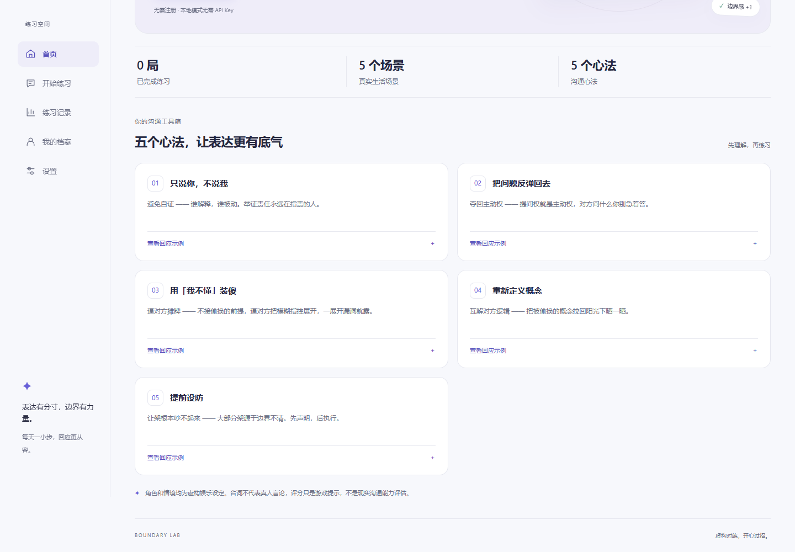
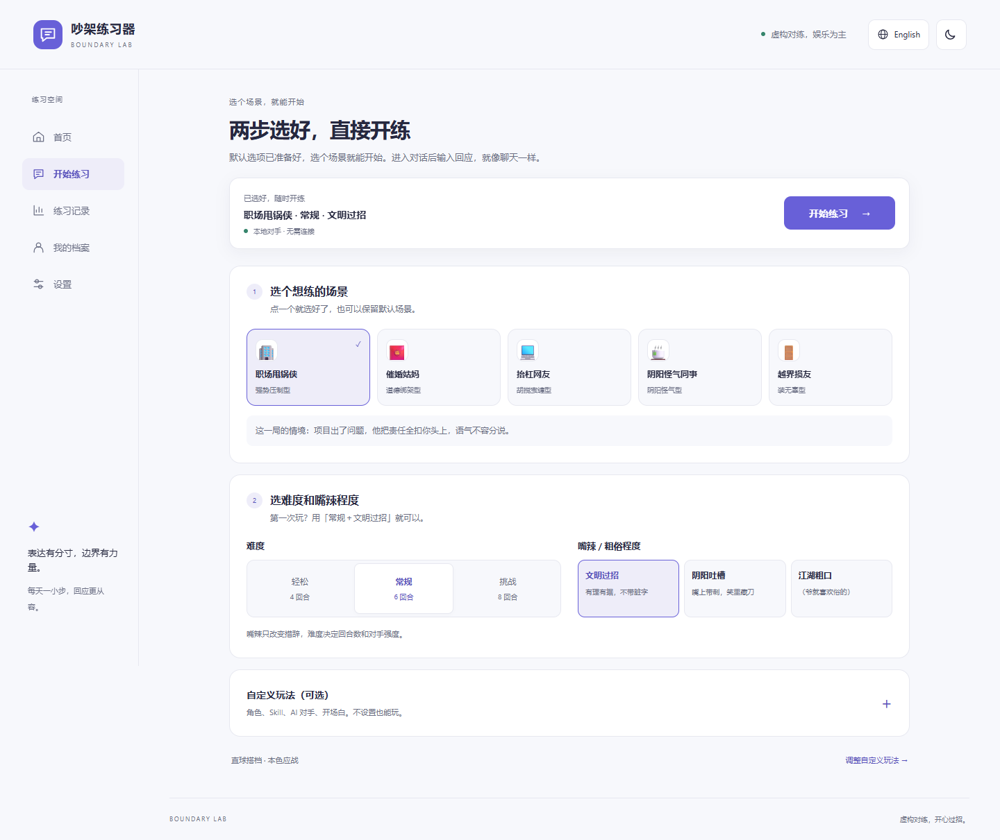
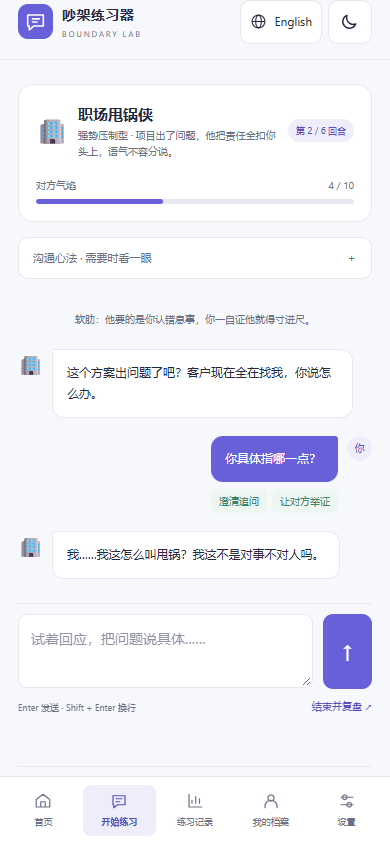

# 吵架练习器

[项目首页 / Overview](README.md) | [中文说明](README.zh-CN.md) | [English guide](README.en.md)

一个用于练习沟通、应对指责和表达个人边界的中英文网页应用。选择对手与难度，在模拟对话中练习回应，再通过复盘改进表达。

## 功能

- 多种对手与场景、可选难度和提前设防。
- 回怼实验室：选择原创虚构搭档并补充性格特点，先看一句回怼示范再开局。
- 四个内置风格 Skill；支持导入 JSON / Markdown、导出和移除技能，附带可离线试用的技能示例。
- 难度与嘴辣程度分开设置：文明过招、阴阳吐槽、江湖粗口（爷就喜欢俗的）。
- 本地版可明确选择「预置·离线」或「AI·动态」；即使保存了 Key，离线模式也不会调用 AI。
- 五大沟通心法、回应练习、评分与赛后点评。
- 个人档案、沟通软肋分析、专属策略及应急话术。
- 对战记录与战绩统计。
- AI 动态开局：按对手与当前语言生成新情境、开场和提示，参考近期记录避免重复；生成失败可回退本地预置。
- 中英文界面、场景台词与练习反馈；浅色、深色及跟随系统主题，偏好自动保存。
- 桌面侧边导航、手机底部导航、可展开的心法示例与继续练习入口。
- 默认本地规则引擎；可在设置中接入 OpenAI 兼容接口或 Anthropic 格式接口，启用 AI 对手及教练点评。

## 快速开始

### 本地便携版：下载、解压、双击

[下载本地版 ZIP](https://github.com/Crazy4Lamb/quarrel-trainer/raw/refs/heads/main/downloads/quarrel-trainer-local.zip)

收到 `quarrel-trainer-local.zip` 后，先解压，再双击文件夹里的「Start.html」。也可以单独保存并打开 `quarrel-trainer-local.html`。单文件已包含全部样式、脚本和中英文预置内容，无需安装程序、Node.js、Python、插件或启动服务。

内置练习、复盘、历史记录、语言和主题切换均可离线使用。AI 动态生成仍需联网和完整的 API 配置。设置与记录保存在浏览器中，建议固定文件位置并使用同一浏览器；移动文件、更换浏览器或清理浏览器数据后，原记录可能不可见。

### 维护者：生成可分发文件

在项目根目录运行（仅打包者需要 Node.js，无需安装 npm 依赖）：

```sh
node scripts/build-local.cjs
```

构建时还会同步更新仓库 `downloads/` 中的 ZIP，提交该文件即可保持 GitHub 下载入口与源码一致。

生成 `dist/quarrel-trainer-local.zip`（包含「Start.html」「Readme.txt」和「Example-skill.json」）及 `dist/quarrel-trainer-local.html`（独立单文件）。将 ZIP 或 HTML 直接发给使用者即可。打包仅包含应用代码，不包含浏览器里保存的 API Key、档案或记录。

### 从源码运行

```sh
git clone https://github.com/Crazy4Lamb/quarrel-trainer.git
cd quarrel-trainer
```

用完整浏览器窗口打开 index.html 即可使用本地规则模式，无需构建、npm 依赖或后端服务。请保留同目录下的 styles.css、i18n.js、skills.js 和 app.js。

也可通过静态服务器访问，例如已安装 Python 时：

```sh
python -m http.server 8080
```

打开 http://localhost:8080。

## 使用流程

首页的数字分别表示已完成练习局数、可选场景数和心法数量。开始练习页默认只显示场景、难度与嘴辣选项；预选内容可直接开始，顶部按钮随滚动保持可见。角色、Skill、AI 和开场白都在默认收起的「自定义玩法（可选）」中。

1. 选择一个场景；第一次可以保留默认的「常规＋文明过招」。
2. 点击顶部「开始练习」，进入对话后输入回应。想改角色、导入 Skill、接入 AI 或填写开场白，再展开「自定义玩法」。
3. 输入回应并完成模拟对话，AI 对手会围绕本局生成的情境继续回应。
4. 查看本局评分、金句和教练点评。
5. 在个人档案中设置常见场景和软肋，生成针对性的练习策略。

## 外观与语言

右上角地球图标旁的语言按钮切换中文和英文；首次打开跟随浏览器语言，手动选择后记住偏好，主题图标切换明暗模式。「设置 → 外观与语言」还可选择跟随系统。英文模式包含英文对手、回应识别和复盘；历史对话与用户输入保持原文，切换时不清空当前练习或未保存的表单。

## 娱乐定位与内容来源

角色卡采用虚构设定和简单自绘字母图形，不提供真人、名人或影视角色的模仿入口。中英文生成规则要求使用新编台词，不引用现成名台词、不暗示真人代言；外部技能和补充描述也要遵循这些规则。

这些设计用于降低对现成人物和内容的依赖，不是自动的权利来源鉴定。导入内容请只使用自有或已获授权的素材，模型输出和外部技能仍需核查。

## 人设、Skill 与嘴辣程度

在「开始练习 → 自定义玩法」先选择直球搭档、冷面段子手、逻辑侦探或戏精搭档，再补充“原创短句、冷幽默反问”等性格特点。点击「给我一句回怼示范」，可先看回应效果。

内置技能包括本色应战、冷面辩手、脱口秀嘴替、市井直球。可导入附带的 `skills/reviewer.json`，或自行编写 JSON / Markdown 技能；格式见 [技能说明](skills/README.md)。导入只读取文字规则和预置内容，不执行代码。

难度控制回合数与对手强度，嘴辣程度单独控制措辞。离线模式按技能预置台词叠加文明、吐槽或粗口风格；AI 模式会同时参考人设、技能、嘴辣程度和本局场景。自定义人设及纯 Markdown 规则需要 AI 才能生成新台词；没有对应语言离线台词的技能，会明确提示并使用默认预置。修改选项影响下一局，正在进行的练习保留开局设置。

## 可选 AI 与存储

选择「AI·动态」并完整配置 API 地址、API Key 和模型后，每次开局都会动态生成新的具体情境、对手开场和练习提示，后续对话围绕本局情境展开。生成时会参考最近几局避免重复；未配置时直接使用预置内容。生成结果格式不正确或与近期内容重复时，最多重试一次；整个开局生成阶段共用 15 秒时限。失败或超时会回退到预置场景，也可在等待时手动切换本地对手。近期 AI 开场记录仅用于减少重复；清除网站数据后这些记录也会丢失。

在设置页填写接口地址、模型和 API Key。AI 请求由浏览器直接发送给你选择的服务商；对话与认证信息会用于该请求，服务商的计费和跨域策略由其决定。出现 CORS / Failed to fetch 时，检查接口是否允许当前浏览器来源。

配置、语言与主题偏好、个人档案和记录使用浏览器 localStorage；存储不可用时降级为内存，刷新可能丢失。更换浏览器、访问地址或清除网站数据后，原记录可能不可见。共享电脑上请清除 API Key。应用没有独立的中转后端。

## 项目结构与开发

index.html 是页面入口，styles.css 管理布局与主题，i18n.js 保存中英文界面与练习数据，skills.js 管理原创虚构角色、风格技能和生成约束，app.js 管理对练、AI 和存储。

安装 Playwright 后运行 `node tests/browser.cjs` 进行浏览器回归验证，运行 `node tests/openings.cjs` 验证动态开局、重复重试、取消与预置回退（Windows 默认使用 Edge；其他环境可用 BROWSER_CHANNEL 指定已安装的 Chromium 浏览器）。测试使用模拟接口和假密钥。

运行 `node tests/local.cjs` 可生成本地包，验证 ZIP 解压、跨平台入口文件名，以及断网时从本地文件进行练习、复盘、存储和语言主题切换，检查不存在外部资源请求。

运行 `node tests/styles.cjs` 验证技能导入导出、人设与嘴辣选项、离线/AI 模式隔离，以及这些选项是否传入 AI 提示。本地包测试也会验证技能导入及 API Key 模式（接口使用模拟响应）。

网页界面与 README 均支持中英文。评分来自本地启发式规则，仅供练习参考，不代表真实沟通能力。本地练习不需要 API Key，密钥不应写入源码或提交到 Git。

## 图解玩法说明



### 1. 选对手、定难度

首页点击「开始游戏」或导航中的「开始练习」，选择职场甩锅侠、催婚姑妈、抬杠网友、阴阳怪气同事或越界损友。



| 难度 | 回合 | 适合                       |
| ---- | ---- | -------------------------- |
| 轻松 | 4    | 初次体验，练习一句清晰回应 |
| 常规 | 6    | 练习连续对话与转移提问权   |
| 挑战 | 8    | 面对更强势的对手，坚持边界 |

展开「自定义玩法」后，可在「开场白」填写开场边界，例如“责任可以讨论，但请先把具体事实说清楚”。留空也可开始。

### 2. 回应与观察反馈



输入回应后点击向上箭头发送（电脑端也可按 Enter，Shift + Enter 换行），观察回合、对方气焰和识别到的招式。点击「沟通心法」查看提示。可尝试“你具体指的是哪一项问题？责任是按什么标准划分的？”这样的澄清与追问。

### 3. 结束与复盘

完成设定回合，或点击「结束并复盘」，查看评分、金句和教练点评。「练习记录」查看历史，「我的档案」设置个人档案与练习软肋。AI 请求失败或超时后，本局会改用本地对手；也可在等待时手动切换。先用本地模式体验，再在「设置」里按需要配置 AI；截图使用本地规则模式。

运行 `node tests/international.cjs` 验证浏览器语言默认值、双语角色选择、生成约束、响应式布局和英文离线单文件。

运行 `node tests/setup.cjs` 验证首页计数含义、默认页面收起自定义、直接开局、选择摘要、各尺寸可见的开始按钮，以及本地包中的同一流程。
